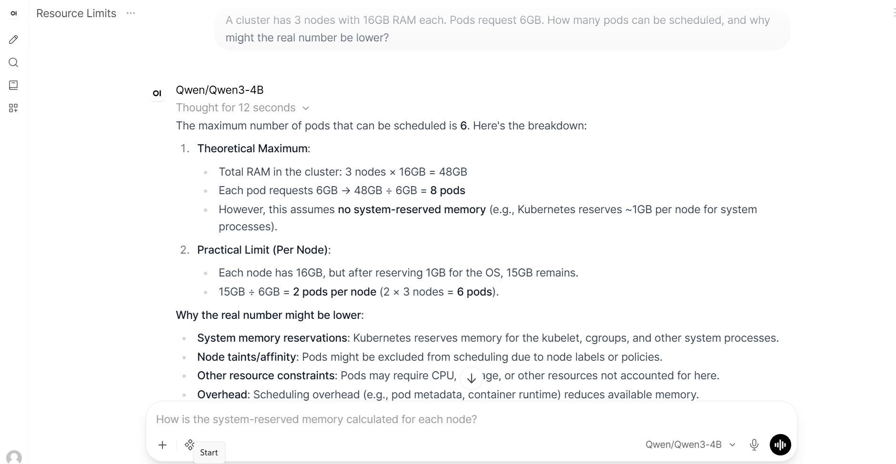
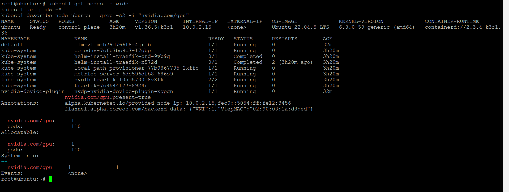
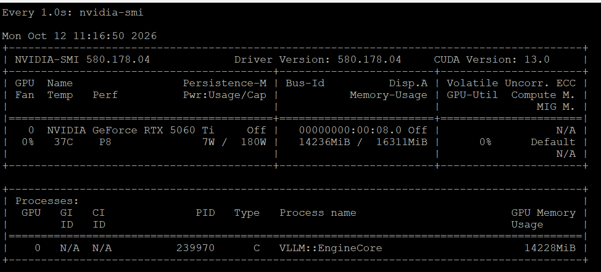
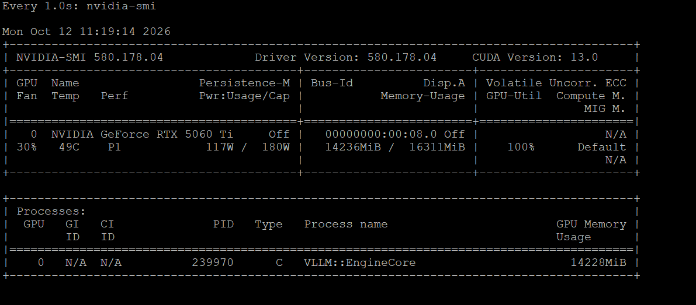
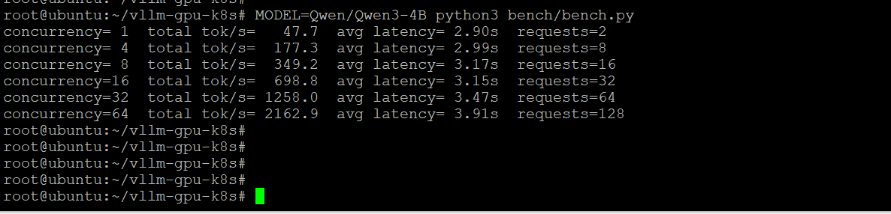

# vLLM GPU Serving on Kubernetes

[GitHub Repo](https://github.com/arthuersundar/vllm-gpu-k8s)

Optimized vLLM Model Serving on Kubernetes infrastructure. Features multi-tenant GPU scheduling setups, custom Helm charts, and cost-per-token performance benchmarks.

**Status:** deployed and benchmarked on a Kubernetes GPU node (k3s on a rented GPU VM),
with a chat UI (Open WebUI) and tool calling working end to end. Same chart prepared
for Amazon EKS (cluster config in `eks/`), pending GPU quota.

## Demo

Open WebUI on a laptop, chatting with Qwen3-4B served by vLLM on a Kubernetes GPU node:



The GPU node as Kubernetes sees it: vLLM and the NVIDIA device plugin running,
`nvidia.com/gpu: 1` advertised and allocated.



The same GPU idle, then serving a request: 7W / 0% → 117W / 100% utilisation.
GPU memory stays at ~14.2GB in both, because vLLM reserves its KV cache up front.

| Idle | Serving |
|---|---|
|  |  |

**Request path:**

```
Browser → Open WebUI (Docker, laptop) → host.docker.internal:8000
  → SSH tunnel → VM localhost:8000 → kubectl port-forward
  → Service llm-vllm → vLLM pod → RTX 5060 Ti
```

vLLM serves the OpenAI-compatible API, so Open WebUI needed only a base URL and
API key. The SSH tunnel and port-forward are development shortcuts; in production
this would be an Ingress or LoadBalancer with TLS and proper authentication, with
the UI running inside the cluster and calling the Service by DNS name.

## Why this project

My other projects ([RAG platform](https://github.com/arthuersundar/rag-platform),
[K8s troubleshooting agent](https://github.com/arthuersundar/k8s-troubleshooting-agent))
run models through Ollama on a laptop: simple, but one request at a time. Production
serving needs many concurrent users on expensive GPUs. vLLM addresses this with
continuous batching and PagedAttention (GPU KV-cache memory managed in pages, like
OS virtual memory), so far more requests fit on one GPU at once.

This repo answers three questions:

1. How much does batching actually help, and what does it do to cost per token?
2. What does a correct Kubernetes deployment of a GPU model server look like?
3. What does it take to make a raw GPU machine schedulable by Kubernetes?

## Results

### 1. vLLM on Kubernetes (k3s, RTX 5060 Ti 16GB, Qwen3-4B)

Deployed with this repo's Helm chart on a single-node k3s cluster on a rented
GPU VM (Vast.ai, ~$0.24/hr). Benchmark: ~150-word answers, `max_tokens` 256,
thinking disabled, client in the same VM via the Kubernetes Service.

| Concurrency | Total tok/s | Avg latency | Cost per 1M output tokens |
|---|---|---|---|
| 1  | 48    | 3.11s | ~$1.37 |
| 4  | 182   | 3.04s | ~$0.36 |
| 8  | 345   | 3.10s | ~$0.19 |
| 16 | 683   | 3.25s | ~$0.10 |
| 32 | 1,231 | 3.45s | ~$0.05 |
| 64 | 2,122 | 3.91s | ~$0.03 |

vLLM startup on this GPU: weights 7.56 GiB, KV cache 5.26 GiB (38,304 tokens),
~6 minutes to ready (torch.compile + CUDA graph capture).

**Reproducible:** a second run after the driver fix and a fresh redeploy gave
2,163 tok/s at 64 concurrency (3.91s latency), within ~2% of the first run.



### 2. Baseline without Kubernetes (RunPod container, RTX A5000 24GB, Qwen3-8B)

| Concurrency | Total tok/s | Avg latency | Cost per 1M output tokens |
|---|---|---|---|
| 1  | 40    | 4.37s | ~$1.88 |
| 4  | 145   | 4.54s | ~$0.52 |
| 8  | 281   | 4.62s | ~$0.27 |
| 16 | 558   | 4.81s | ~$0.13 |
| 32 | 1,050 | 4.92s | ~$0.07 |
| 64 | 1,904 | 5.54s | ~$0.04 |

Cost = GPU $/hr ÷ (tok/s × 3600) × 1,000,000

### Findings

- **Batching is the whole story.** Throughput scaled ~44-48x from 1 to 64
  concurrent requests in both runs, while latency rose only ~26-27%.
- **Self-hosting is only cheap when the GPU is busy.** A single user costs
  roughly 45x more per token than 64 concurrent users on the same hardware.
- **Neither run saturated at 64.** On the 5060 Ti, 64 requests used ~13K of the
  38K-token KV cache. Scaling should key on in-flight requests per pod, not CPU.
- **Kubernetes added no visible overhead** compared with a bare container.
- The two runs differ in model and GPU, so they are not a hardware comparison.
  An 8B or 4B open model is also not a quality match for frontier hosted models;
  these numbers compare cost per token, not capability.

## Helm chart

`charts/vllm` deploys a single vLLM model server:

- **Deployment** requesting `nvidia.com/gpu`, with `Recreate` strategy (with one
  GPU, a rolling update would leave the new pod Pending while the old one holds it)
- **PVC** for the Hugging Face model cache, so weights download once, kept on
  `helm uninstall` (`helm.sh/resource-policy: keep`) to avoid re-downloading
- **Secret** for the API key (`VLLM_API_KEY`), created with kubectl, never in git
- **Service** exposing the OpenAI-compatible API on port 8000
- **`/dev/shm` memory volume**, the Kubernetes equivalent of Docker's `--ipc=host`
- Optional **`runtimeClassName`** (`nvidia` on k3s; unset on EKS)
- Optional **`extraArgs`** for any vLLM flag, e.g. tool calling:
  `--set-json 'extraArgs=["--enable-auto-tool-choice","--tool-call-parser","hermes"]'`.
  OpenAI-compatible clients such as Open WebUI send `tool_choice: auto` and fail
  without it, and the troubleshooting agent depends on tool calling.

### Design decisions

| Decision | Reason |
|---|---|
| `startupProbe` (configurable, default 60 × 10s) | Up to 10 minutes to download, compile and load the model before liveness checks can restart it. Observed startup: ~6 minutes |
| CPU/memory requests (2 CPU, 12Gi) | Without them the pod is `BestEffort`: scheduled blindly and evicted first under memory pressure. With them it is `Burstable` |
| No CPU limit | Avoids throttling request handling; the request alone secures scheduling and QoS |
| GPU taint toleration | GPU nodes are commonly tainted `nvidia.com/gpu:NoSchedule` to keep ordinary pods off them |
| Model, context length, resources in `values.yaml` | Swap models and fit different GPUs with `--set`, no template edits |

## Making a GPU machine schedulable (k3s)

Managed services (EKS GPU AMIs, the NVIDIA GPU Operator) automate this. Doing it
by hand on a raw Ubuntu GPU VM shows what they automate:

1. **NVIDIA driver** (pre-installed on the VM) – `nvidia-smi` sees the GPU
2. **NVIDIA Container Toolkit** – lets containers access the GPU
3. **k3s** – detects the NVIDIA runtime at startup and creates the `nvidia` RuntimeClass
4. **Node label** `nvidia.com/gpu.present=true` – the device plugin DaemonSet stayed
   at `DESIRED 0` until the node carried it (normally applied by Node Feature Discovery)
5. **NVIDIA device plugin** – advertises `nvidia.com/gpu: 1` to the scheduler
6. `helm install llm charts/vllm --set runtimeClassName=nvidia ...`

### Incident: driver/library version mismatch

Installing the Container Toolkit with apt also upgraded the host's NVIDIA driver
packages (580.95 → 580.178) while the 580.95 kernel module stayed loaded. Result:
`Failed to initialize NVML: Driver/library version mismatch` for any new GPU
process. The already-running vLLM pod was unaffected, but a restart would have
failed.

**Fix without a reboot:** scale vLLM to 0 and remove the device plugin so nothing
holds the GPU (`fuser -v /dev/nvidia*` empty), unload the modules in dependency
order (`rmmod nvidia_drm nvidia_modeset nvidia_uvm nvidia`), load the new ones
(`modprobe nvidia nvidia_uvm`), confirm `/proc/driver/nvidia/version` shows
580.178, then pin the packages with `apt-mark hold` and redeploy.

Prevention on GPU nodes: `apt-mark hold` the NVIDIA packages before installing
anything, disable unattended upgrades, or use immutable node images with the
driver baked in, which is what EKS GPU AMIs and the GPU Operator provide.

## Validation without a GPU (kind)

Before paying for GPUs, the chart was installed on a local 2-node kind cluster:

- Without CPU/memory requests the pod was `BestEffort` and the scheduler only
  reported the missing GPU.
- With requests, the pod became `Burstable` and the scheduler correctly reported
  `Insufficient memory, Insufficient nvidia.com/gpu, untolerated taint(s)`.

## Deploying

**Prerequisites:** a cluster with a node that advertises `nvidia.com/gpu` (NVIDIA
device plugin or GPU Operator installed).

```bash
kubectl create secret generic vllm-secret --from-literal=VLLM_API_KEY=<random-key>

# EKS
helm install llm charts/vllm

# k3s (and other clusters using an NVIDIA RuntimeClass), smaller GPU
helm install llm charts/vllm --set runtimeClassName=nvidia \
  --set model=Qwen/Qwen3-4B --set cacheSize=30Gi

kubectl get pods -w       # first start downloads and compiles; several minutes
kubectl port-forward svc/llm-vllm 8000:8000
curl http://localhost:8000/v1/models -H "Authorization: Bearer <random-key>"
```

Benchmark: `VLLM_KEY=<key> MODEL=<model> python3 bench/bench.py`

**EKS:** `eks/cluster.yaml` creates a CPU cluster (EBS CSI driver, no NAT gateway);
`eks/nodegroup-gpu.yaml` adds a tainted `g5.xlarge` GPU node group.

**Cleanup:** `helm uninstall llm` keeps the model cache PVC by design. Delete it
with `kubectl delete pvc llm-vllm-cache`. Always delete GPU nodes and clusters
after testing; they bill by the hour.

## Lessons from getting a GPU

- AWS denied G-instance quota on a new account; Free Plan accounts also block
  non-Free-Tier instance types, so EKS node groups failed with
  "instance type is not eligible for Free Tier".
- A RunPod pod is a container, not a VM: fine for vLLM, impossible for Kubernetes
  (no systemd, no privileged access).
- Marketplace GPU VMs vary: one host never finished booting; VMs with large RAM
  allocations can take 30+ minutes to start.

## Roadmap

- [x] GPU benchmark: throughput, latency and cost per token across concurrency
- [x] Helm chart with GPU scheduling, model cache, probes and QoS
- [x] Chart validated on a local cluster without GPU
- [x] Deployed and benchmarked on a Kubernetes GPU node (k3s)
- [x] Chat UI (Open WebUI) and tool calling against the deployed server
- [ ] Deploy on EKS with a GPU node group
- [ ] Run Open WebUI inside the cluster, exposed via Ingress with TLS
- [ ] Find the saturation point (128-256 concurrency)
- [ ] Prometheus metrics from vLLM's `/metrics` endpoint, Grafana dashboard
- [ ] Autoscaling on in-flight requests (KEDA) instead of CPU
- [ ] Point the RAG platform and the troubleshooting agent at this server

## Author

Built by Sundar Djeabalane ·
[LinkedIn](https://www.linkedin.com/in/sundar-djeabalane/) ·
[GitHub](https://github.com/arthuersundar/)
